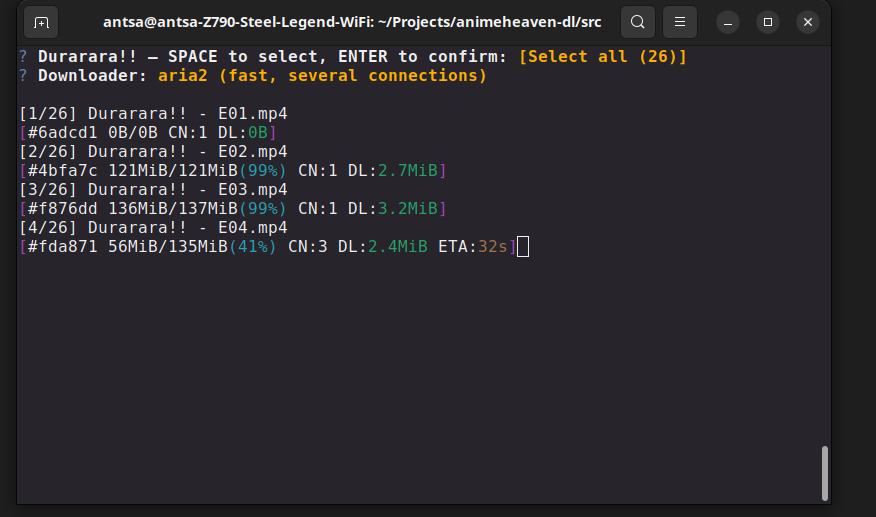

# anime-dl (anime downloader)

**anime-dl** is a CLI tool to search and download anime episodes from
https://animeheaven.me quickly and easily.

It uses **aria2** and/or **wget** to ensure fast and reliable downloads.

---

## Features

- Search shows available on **animeheaven.me**
- Select one, several or all episodes directly from the terminal
- Download using **aria2** (several connections) or **wget**
- Resume interrupted downloads: run the same selection again
- One folder per show, with clean file names (`Durarara!! - E01.mp4`)
- Settings: certificate checking, default downloader

---

## Installation

### ❗❗ Requirements

- **Python 3.10** or newer
- **aria2** and/or **wget** installed on your system

```bash
# Ubuntu / Debian
sudo apt install aria2 wget
```

### Clone the repository

```bash
git clone https://github.com/Nyndow/anime-dl
cd anime-dl
python3 -m venv .venv
source .venv/bin/activate
pip install -r requirements.txt
```

### Choose the download folder

Copy the example file:

```bash
cp .env.example .env
```

and set the folder in `.env`:

```bash
DOWNLOAD_PATH=~/Videos/anime-dl
```

Without a `.env`, videos are saved in `./downloads`.

### Run

```bash
cd src
python main.py
```

---

## Usage

Use the **arrow keys** to move, **Enter** to confirm, and **Space** to tick
episodes. **Ctrl+C** goes back or quits.

### 1. Search for a show

Choose **Search** in the main menu, type a title (e.g. `Durarara`) and pick a
show from the results.

### 2. Select the episodes

Tick the episodes you want with **Space**, or tick **Select all**, then press
**Enter**.

### 3. Choose the downloader

- **aria2**: faster, downloads with several connections
- **wget**: simple, single connection

The question is skipped if only one of them is installed, or if a default
downloader is set in the settings.

### 4. Download

Each episode shows its own progress line:



Episodes are downloaded one after the other into:

```
<DOWNLOAD_PATH>/<show title>/<show title> - E01.mp4
```

At the end, the tool shows how many episodes were downloaded and lists the
ones that failed.

### Resume an interrupted download

Press **Ctrl+C** to stop: the partial files are kept. Start the tool again,
select the same episodes and the download continues where it stopped.

### Settings

- **Certificate check**: if you get a certificate error, update your system
  certificates, or disable the check here (be aware of the risks).
- **Default downloader**: `ask`, `aria2` or `wget`.

Settings are saved in `config/settings.json`.

---

## Troubleshooting

- Errors are written to `logs/anime-dl.log`, not to the screen: check it
  when a search or a download fails.
- A video server can be slow to answer; if an episode fails, run the tool
  again to retry it.

---

## Disclaimer

This project is created for educational purposes only.
I am not affiliated with animeheaven.me.
Use this tool responsibly and respect the website's terms of service.
